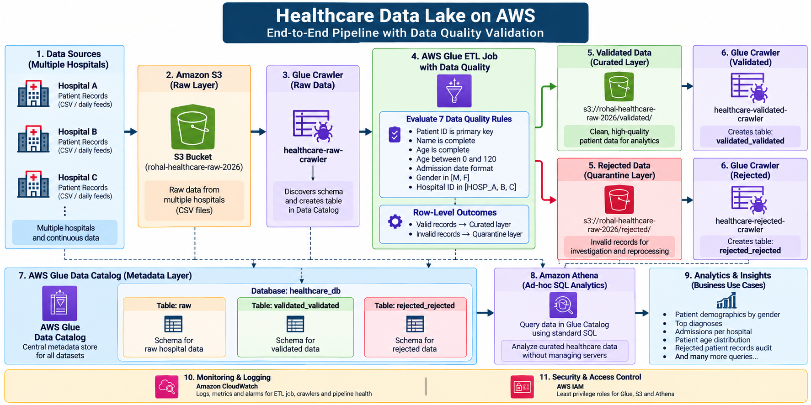

# Healthcare Data Lake on AWS

A serverless healthcare data engineering project built on AWS that
ingests patient data from multiple hospitals, performs automated data
quality validation, separates valid and rejected records, catalogs the
resulting datasets, and enables SQL analytics using Amazon Athena.

## Architecture

Hospital CSV Files
→ Amazon S3 (Raw)
→ AWS Glue Data Catalog
→ AWS Glue ETL + Data Quality
→ Validated / Rejected S3 Layers
→ AWS Glue Data Catalog
→ Amazon Athena
→ Analytics Reports



## Tech Stack

- Amazon S3
- AWS Glue Crawlers
- AWS Glue Data Catalog
- AWS Glue ETL
- AWS Glue Data Quality
- Apache Spark / PySpark
- Amazon Athena
- AWS IAM
- Amazon CloudWatch
- SQL
- Python

## Project Workflow

### 1. Data Ingestion

Patient CSV files from three hospitals are uploaded to the raw layer
of the Amazon S3 data lake.

### 2. Data Cataloging

The `healthcare-raw-crawler` scans the raw S3 data and registers its
schema in the AWS Glue Data Catalog under the `healthcare_db` database.

### 3. Data Quality Validation

An AWS Glue ETL job evaluates each patient record using Data Quality
Definition Language (DQDL) rules.

The pipeline validates:

- Patient ID completeness and uniqueness
- Name completeness
- Age completeness
- Age range between 0 and 120
- Admission date format
- Gender values
- Hospital identifiers

### 4. Row-Level Quality Routing

AWS Glue generates row-level data quality outcomes.

Records that pass all configured rules are written to:

`s3://rohal-healthcare-raw-2026/validated/`

Records that fail one or more rules are quarantined in:

`s3://rohal-healthcare-raw-2026/rejected/`

This prevents invalid records from entering the analytics layer while
preserving them for investigation and reprocessing.

## Data Quality Results

The sample dataset contains 25 patient records.

| Layer | Records |
|---|---:|
| Raw | 25 |
| Validated | 19 |
| Rejected | 6 |

The reconciliation confirms:

`19 validated + 6 rejected = 25 raw records`

The Data Quality evaluation detected issues including:

- Duplicate patient identifiers
- Missing age values
- Negative age values
- Out-of-range age values

## Glue Data Catalog

The project uses the following database:

`healthcare_db`

Important tables:

- `raw` — original hospital data
- `validated_validated` — records that passed validation
- `rejected_rejected` — quarantined records

## Analytics

Amazon Athena queries the validated dataset without requiring a
traditional database server.

Five reports are included:

1. Patient demographics by gender
2. Top diagnoses
3. Admissions per hospital
4. Patient age distribution
5. Rejected patient records audit

SQL queries are available in:

`sql/athena_reports.sql`

Query outputs are available in:

`reports/`

## Repository Structure

healthcare-data-lake-aws/
├── README.md
├── .gitignore
├── docs/
│   ├── architecture.png
│   └── data-model.md
├── sample-data/
│   ├── hospital_a_patients.csv
│   ├── hospital_b_patients.csv
│   └── hospital_c_patients.csv
├── glue/
│   ├── healthcare_dq_pipeline.py
│   └── dq_ruleset.txt
├── sql/
│   └── athena_reports.sql
└── reports/
    ├── patient_demographics_by_gender.csv
    ├── top_diagnoses.csv
    ├── admissions_per_hospital.csv
    ├── patient_age_distribution.csv
    └── rejected_patient_audit.csv

## Key Engineering Concepts Demonstrated

- Serverless data lake architecture
- Raw and curated data layers
- Automated schema discovery
- Data quality validation
- Row-level validation
- Data quarantine pattern
- Data reconciliation
- ETL with Apache Spark
- Metadata management with AWS Glue Data Catalog
- Serverless SQL analytics with Amazon Athena

## Data Quality Rules

The pipeline applies seven DQDL rules:

```text
Rules = [
    IsPrimaryKey "patient_id",
    IsComplete "name",
    IsComplete "age",
    ColumnValues "age" between 0 and 120,
    ColumnValues "admission_date" matches "\d{4}-\d{2}-\d{2}",
    ColumnValues "gender" in ["M", "F"],
    ColumnValues "hospital_id" in ["HOSP_A", "HOSP_B", "HOSP_C"]
]